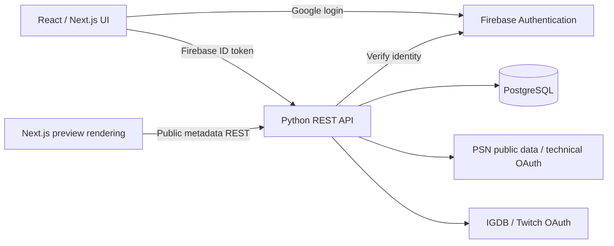

# Python backend: product and interview case study

## Objective

Evolve Trophy Buddy into a React frontend backed by a dedicated Python REST API. The implementation should provide a real product feature and evidence of engineering decisions: contracts, authentication, data isolation, tests, failures and deployment. A personal project is practical Python experience; it does not replace or establish past professional production experience in Python.

The product remains a spoiler-aware trophy companion. Backend migration supports that roadmap rather than becoming a collection of disconnected technology demonstrations.

## Architecture decision

The accepted storage ownership and Next.js/Python boundary are specified in [ADR 001](adr-001-data-and-service-boundaries.md). PostgreSQL owns product data and Firebase Authentication owns identity. Firestore has been removed from runtime application access.

Keep this Python API in its own project/repository, independent of the React frontend. Use a modular Python service with separate API and worker processes. Start with one deployable backend and clear integration boundaries; split services only when ownership, scaling or failure isolation justify it.

| Responsibility         | Selected technology                         | Why it fits this product                                                                  |
| ---------------------- | ------------------------------------------- | ----------------------------------------------------------------------------------------- |
| REST API               | FastAPI + Pydantic                          | Typed request/response validation, dependency injection, generated OpenAPI                |
| Runtime                | Python 3.12 initially; CI also targets 3.13 | Reproducible, explicit interpreter support                                                |
| Dependency management  | uv + lockfile                               | Repeatable environments and CI installations                                              |
| Relational storage     | PostgreSQL                                  | Account associations, guide versions, jobs and progress with constraints and transactions |
| Database access        | SQLAlchemy + psycopg                        | Explicit transactions and established Python database tooling                             |
| Schema migrations      | Alembic                                     | Reviewed, versioned database changes                                                      |
| Authentication         | Existing Firebase Auth initially            | Preserve working Google login; validate signed tokens in Python                           |
| External HTTP          | HTTPX                                       | Timeouts, connection reuse and async clients where appropriate                            |
| Durable workflows      | Temporal Python SDK                         | Imports and guide ingestion spanning multiple external requests and retries               |
| Guide analysis         | AWS Bedrock through Boto3                   | Structured guide extraction with evidence, validation and cost controls                   |
| Tests and quality      | pytest, HTTPX, Ruff, mypy                   | API behavior, domain rules, type checking and consistent formatting                       |
| Frontend evidence      | Storybook + Playwright                      | Reusable states and authenticated user flows across desktop/mobile                        |
| Telemetry              | OpenTelemetry + Grafana stack               | Correlate HTTP requests, background jobs and integration failures                         |
| Packaging and delivery | Docker + GitHub Actions                     | Portable runtime and repeatable checks                                                    |
| Cloud infrastructure   | AWS + Terraform                             | Reviewed infrastructure and least-privilege identity when deployment is ready             |

Temporal, Bedrock, OpenTelemetry exporters, Grafana, Terraform, Storybook and Playwright remain **planned**. PostgreSQL persistence and PSN/IGDB integrations are implemented. Docker packaging and the GitHub Actions workflow are provided; successful hosted runs must be recorded separately after execution.

## Implemented Python backend

The independent API now owns all previously implemented Node domain flows: Firebase token validation, library reads/statistics, public PSN imports, dedicated encrypted renewable sessions, trophy detail snapshots and optional IGDB enrichment. PostgreSQL is the only application database. Next.js owns rendering, UI, localization and login UI; its old domain routes and provider dependencies have been removed.

Libraries and their game entries use relational identity/progress columns, foreign keys and checks. Trophy sets, groups, definitions and per-import profile earnings now use relational tables. Detail import metadata and optional provider catalogue snapshots retain validated JSONB. Guide models remain the next domain delivery. See README for actual tables and endpoints.

Import publication is atomic and fenced by a database lease. External calls happen outside SQL transactions. Details are resolved from saved user context, and publication rejects concurrent profile/generation changes. A matching cache hit makes no PSN request. Failed imports preserve the last committed result. The current import remains synchronous; leases do not make interrupted operations durable.

No application code accesses Firestore. Existing cloud documents were not deleted; libraries can be rebuilt from PSN without a data migration. Firebase Authentication remains in use independently.

## Next deliveries, in dependency order

### 1. Validate and deploy the migrated API independently

Validate PostgreSQL-backed user isolation, failed import preservation, session refresh, complete pagination, cached details and React calls. Run migrations once as a release step before switching the deployed frontend API URL. Configure PostgreSQL backups, TLS/network access, bounded connection pools, HTTPS, CORS and service secrets. Container execution and cloud deployment require their own verification.

### 2. Evolve relational domains when product features require them

Introduce shared game/release identities, trophy definitions and guide versions with explicit provenance and constraints. Current detailed JSONB snapshots are a deliberate cache boundary, not proof that those future models exist. Do not add unused tables simply to demonstrate a technology.

### 3. Harden provider operations with measured limits

The Python HTTPX adapter ports the Sony endpoint behavior previously validated in Node; it does not depend on PSNAWP or private wrapper fields. Community endpoints may change. Keep transport tests, identity guards, timeouts and live smoke checks. Demonstrate session renewal and failure recovery. Coordinate aggregate provider limits across replicas before scaling beyond the MVP.

### 4. Make library imports durable with Temporal

Provide `POST /api/v1/library/sync` returning `202 Accepted` plus an operation URL. A worker executes bounded PSN/IGDB activities, publishes the snapshot transactionally and updates operation state. The UI polls a status endpoint initially; streaming can follow if useful.

Demonstrate timeouts, bounded retries with backoff, non-retryable authentication failures, activity idempotency, pagination checkpoints and recovery after worker interruption. Workflow code must remain deterministic; network calls belong in activities. Temporal does not automatically make external side effects exactly once. Define concurrency and rate limits at the dedicated PSN service boundary.

Use Temporal's task queues rather than adding Redis/RabbitMQ/Celery merely to satisfy a technology list. Add a broker only if a separate event distribution requirement warrants it.

### 5. Add the first real guide ingestion workflow

Choose permitted guide sources and a small set of games. Persist source, evidence, extraction schema/model version, processing state and review state. A Bedrock activity extracts structured guide candidates; deterministic validation checks required fields, missing evidence and conflicting claims before publication.

Never let source text act as system instructions. Retain uncertainty and explicit unknown states. Limit request sizes, token budgets, retries and cost. Evaluate extraction on a small reviewed dataset. Cache a versioned guide shared across users; keep personal progress separate.

### 6. Connect the Platinum Overview and Companion

Use real guide fields for runs, missables and platinum time. Apply deterministic rules to the guide, earned trophies and explicit player context. Persist checklist and checkpoint progress. Do not infer exact campaign position from trophies alone. Demonstrate spoiler concealment and individual reveals in Playwright and component states in Storybook.

### 7. Add operational evidence and cloud deployment

Trace API requests, workflow starts and activities using OpenTelemetry. Use structured logs and correlate request IDs with workflow/job IDs; never record bearer tokens, NPSSO or private key values. Add dashboards for import success, latency, retries and provider errors, with actionable alerts.

Deploy the frontend on Vercel and the Python API/worker as separate services. Evaluate ECS/Fargate for long-lived containers and an HTTP ingress; use API Gateway only with a justified routing/auth requirement. Lambda can suit short API calls, but durable workers have different lifecycle needs. Confirm costs before provisioning paid infrastructure.

Terraform defines the selected infrastructure; GitHub Actions checks, packages and deploys using short-lived AWS identity through OIDC. Establish migrations, rollback, readiness checks and secret management before presenting the deployment as production-ready.

## Interview demonstration

Prepare a short English walkthrough with:

1. The product problem and why imports should survive request/worker failures.
2. A React-to-Python authenticated request, its OpenAPI contract and user-scoped data.
3. PostgreSQL schema constraints and a reviewed Alembic migration once implemented.
4. A real failed import and successful retry/recovery once Temporal is implemented.
5. A test proving a security or domain boundary and a trace explaining a failure.
6. A guide extraction example with evidence and uncertainty once Bedrock is implemented.
7. An explanation of AI-assisted work: what was generated, what was reviewed, what failed and what changed.

Be precise about personal contributions, assisted implementation, local validation and actual hosted operation. A strong presentation can say: "My production backend experience is in Node.js. I built this Python service to apply the same engineering principles and validate the differences in practice."

Before an interview, the developer should personally implement a small change, debug a failure and explain transaction boundaries, synchronous versus asynchronous I/O, token validation and retry/idempotency decisions without relying on generated answers.

## References

- [FastAPI features](https://fastapi.tiangolo.com/features/)
- [SQLAlchemy documentation](https://docs.sqlalchemy.org/)
- [Alembic documentation](https://alembic.sqlalchemy.org/)
- [Temporal Python SDK](https://docs.temporal.io/develop/python)
- [Bedrock examples with Boto3](https://docs.aws.amazon.com/bedrock/latest/userguide/getting-started-api-ex-python.html)
- [uv projects](https://docs.astral.sh/uv/guides/projects/)
- [PSNAWP documentation](https://psnawp.readthedocs.io/en/latest/)
