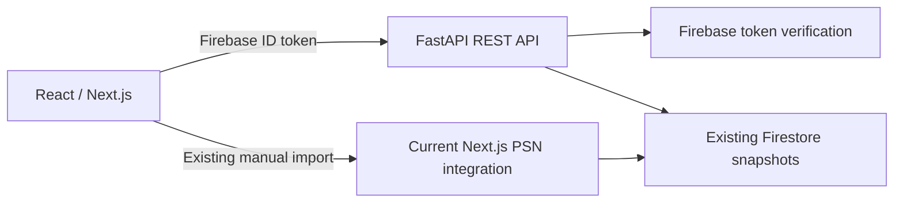

# Python backend: product and interview case study

## Objective

Evolve Trophy Buddy into a React frontend backed by a dedicated Python REST API. The implementation should provide a real product feature and evidence of engineering decisions: contracts, authentication, data isolation, tests, failures and deployment. A personal project is practical Python experience; it does not replace or establish past professional production experience in Python.

The product remains a spoiler-aware trophy companion. Backend migration supports that roadmap rather than becoming a collection of disconnected technology demonstrations.

## Architecture decision

Keep this Python API in its own project/repository, independent of the React frontend. Use a modular Python service with separate API and worker processes. Start with one deployable backend and clear integration boundaries; split services only when ownership, scaling or failure isolation justify it.

| Responsibility         | Selected technology                         | Why it fits this product                                                                  |
| ---------------------- | ------------------------------------------- | ----------------------------------------------------------------------------------------- |
| REST API               | FastAPI + Pydantic                          | Typed request/response validation, dependency injection, generated OpenAPI                |
| Runtime                | Python 3.12 initially; CI also targets 3.13 | Reproducible, explicit interpreter support                                                |
| Dependency management  | uv + lockfile                               | Repeatable environments and CI installations                                              |
| Relational storage     | PostgreSQL                                  | Account associations, guide versions, jobs and progress with constraints and transactions |
| Database access        | SQLAlchemy + psycopg                        | Explicit transactions and established Python database tooling                             |
| Schema migrations      | Alembic                                     | Reviewed, versioned database changes                                                      |
| Authentication         | Existing Firebase Auth initially            | Preserve working Google login; validate signed tokens in Python                           |
| External HTTP          | HTTPX                                       | Timeouts, connection reuse and async clients where appropriate                            |
| Durable workflows      | Temporal Python SDK                         | Imports and guide ingestion spanning multiple external requests and retries               |
| Guide analysis         | AWS Bedrock through Boto3                   | Structured guide extraction with evidence, validation and cost controls                   |
| Tests and quality      | pytest, HTTPX, Ruff, mypy                   | API behavior, domain rules, type checking and consistent formatting                       |
| Frontend evidence      | Storybook + Playwright                      | Reusable states and authenticated user flows across desktop/mobile                        |
| Telemetry              | OpenTelemetry + Grafana stack               | Correlate HTTP requests, background jobs and integration failures                         |
| Packaging and delivery | Docker + GitHub Actions                     | Portable runtime and repeatable checks                                                    |
| Cloud infrastructure   | AWS + Terraform                             | Reviewed infrastructure and least-privilege identity when deployment is ready             |

PostgreSQL, Temporal, Bedrock, OpenTelemetry exporters, Grafana, Terraform, Storybook and Playwright are **planned**, not implemented by this first slice. Docker packaging and the GitHub Actions workflow are provided; successful hosted runs must be recorded separately after execution.

## Implemented first slice

The Python service owns Firebase token validation, snapshot validation, library reads and library statistics. It reads the existing Firestore document directly; it is not an HTTP proxy to Next.js.

An optional `NEXT_PUBLIC_LIBRARY_API_URL` switches only React library reads to Python. Synchronization and detailed trophy refreshes remain in Node until their adapters and orchestration are migrated. Both runtimes use the same snapshot source, avoiding dual writes and divergent stores.

Acceptance evidence:

- Anonymous, expired and revoked sessions are rejected before storage access.
- A client-supplied UID cannot select another user's snapshot.
- Unknown trophy progress remains distinct from confirmed zero.
- Earned platinum remains independent of DLC completion.
- Existing snapshot timestamps and official percentages retain their meaning.
- Provider failures return controlled errors and preserve the existing library.
- OpenAPI describes the actual REST response contracts.

## Next deliveries, in dependency order

### 1. Validate the first Python slice end to end

Run the API locally, route React library reads through it, inspect the authenticated request in browser Network, and demonstrate the statistics endpoint in Swagger. Run pytest, Ruff and mypy. Build and run the container when Docker is available. Run the workflow on GitHub after an explicitly authorized push.

### 2. Introduce PostgreSQL with a controlled data migration

Model users by Firebase UID; keep public PSN profile identity separate from ownership. Separate catalogue identity, user progress and guide content. Use Alembic for schema changes, unique keys for PSN title/trophy-set identities, and foreign keys for user associations. Start with PostgreSQL integration tests, not SQLite as proof of PostgreSQL behavior.

Write an explicit, idempotent import from existing Firestore snapshots. Dry-run counts and compare progress before switching the source of truth. Do not let Node keep writing only Firestore after Python begins reading only PostgreSQL. Change the write path and read path together or provide one explicit temporary compatibility path. Retain a rollback path and do not delete existing data automatically.

### 3. Migrate PSN and IGDB adapters to Python

Evaluate PSNAWP against a real public profile, checking both played games and trophy titles, pagination, complete title IDs, PS4/PS5 service distinctions, detailed trophies and DLC groups. A package's existence does not prove compatibility with the current Sony endpoints.

Preserve the dedicated service identity and renewable encrypted session. End users continue to supply only an Online ID. Determine whether the Python wrapper supports importing/exporting the current session; do not rely on private package fields without an explicit compatibility decision. Preserve authenticated encryption or perform an explicit session migration/reconnection. Define stable adapter contracts so wrapper details do not enter domain logic.

Port IGDB OAuth, conservative catalogue matching and source attribution. Do not reinterpret campaign estimates as platinum estimates. Preserve unknown values and secret-trophy behavior.

### 4. Make library imports durable with Temporal

Provide `POST /api/v1/library/sync` returning `202 Accepted` plus an operation URL. A worker executes bounded PSN/IGDB activities, publishes the snapshot transactionally and updates operation state. The UI polls a status endpoint initially; streaming can follow if useful.

Demonstrate timeouts, bounded retries with backoff, non-retryable authentication failures, activity idempotency, pagination checkpoints and recovery after worker interruption. Workflow code must remain deterministic; network calls belong in activities. Temporal does not automatically make external side effects exactly once. Define concurrency and rate limits at the dedicated PSN service boundary.

Use Temporal's task queues rather than adding Redis/RabbitMQ/Celery merely to satisfy a technology list. Add a broker only if a separate event distribution requirement warrants it.

### 5. Add the first real guide ingestion workflow

Choose permitted guide sources and a small set of games. Persist source, evidence, extraction schema/model version, processing state and review state. A Bedrock activity extracts structured guide candidates; deterministic validation checks required fields, missing evidence and conflicting claims before publication.

Never let source text act as system instructions. Retain uncertainty and explicit unknown states. Limit request sizes, token budgets, retries and cost. Evaluate extraction on a small reviewed dataset. Cache a versioned guide shared across users; keep personal progress separate.

### 6. Connect the Platinum Overview and Companion

Use real guide fields for runs, missables and platinum time. Apply deterministic rules to the guide, earned trophies and explicit player context. Persist checklist and checkpoint progress. Do not infer exact campaign position from trophies alone. Demonstrate spoiler concealment and individual reveals in Playwright and component states in Storybook.

### 7. Add operational evidence and cloud deployment

Trace API requests, workflow starts and activities using OpenTelemetry. Use structured logs and correlate request IDs with workflow/job IDs; never record bearer tokens, NPSSO or private key values. Add dashboards for import success, latency, retries and provider errors, with actionable alerts.

Deploy the frontend on Vercel and the Python API/worker as separate services. Evaluate ECS/Fargate for long-lived containers and an HTTP ingress; use API Gateway only with a justified routing/auth requirement. Lambda can suit short API calls, but durable workers have different lifecycle needs. Confirm costs before provisioning paid infrastructure.

Terraform defines the selected infrastructure; GitHub Actions checks, packages and deploys using short-lived AWS identity through OIDC. Establish migrations, rollback, readiness checks and secret management before presenting the deployment as production-ready.

## Interview demonstration

Prepare a short English walkthrough with:

1. The product problem and why imports should survive request/worker failures.
2. A React-to-Python authenticated request, its OpenAPI contract and user-scoped data.
3. PostgreSQL schema constraints and a reviewed Alembic migration once implemented.
4. A real failed import and successful retry/recovery once Temporal is implemented.
5. A test proving a security or domain boundary and a trace explaining a failure.
6. A guide extraction example with evidence and uncertainty once Bedrock is implemented.
7. An explanation of AI-assisted work: what was generated, what was reviewed, what failed and what changed.

Be precise about personal contributions, assisted implementation, local validation and actual hosted operation. A strong presentation can say: "My production backend experience is in Node.js. I built this Python service to apply the same engineering principles and validate the differences in practice."

Before an interview, the developer should personally implement a small change, debug a failure and explain transaction boundaries, synchronous versus asynchronous I/O, token validation and retry/idempotency decisions without relying on generated answers.

## References

- [FastAPI features](https://fastapi.tiangolo.com/features/)
- [SQLAlchemy documentation](https://docs.sqlalchemy.org/)
- [Alembic documentation](https://alembic.sqlalchemy.org/)
- [Temporal Python SDK](https://docs.temporal.io/develop/python)
- [Bedrock examples with Boto3](https://docs.aws.amazon.com/bedrock/latest/userguide/getting-started-api-ex-python.html)
- [uv projects](https://docs.astral.sh/uv/guides/projects/)
- [PSNAWP documentation](https://psnawp.readthedocs.io/en/latest/)
