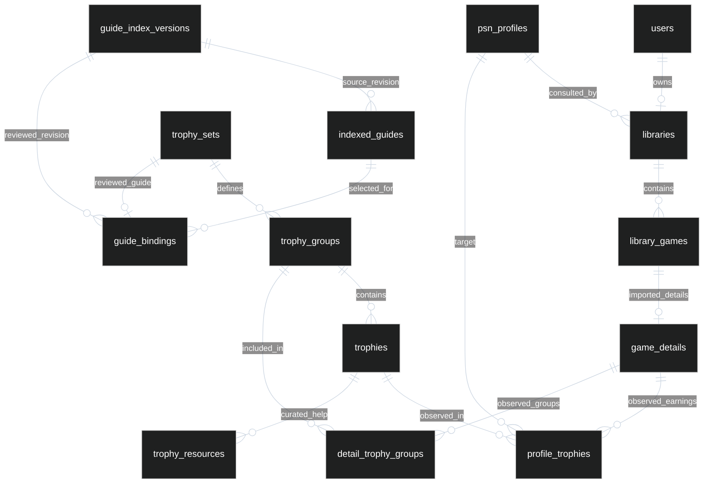

# Product relationships

`users.uid` is the server-verified Firebase UID. Firebase remains the identity provider; PSN account IDs belong to independent public profiles. A library association does not prove ownership of the PSN account.

`library_games` and `game_details` use `(uid, game_id)` compound keys. Private observations cascade with their details. Definition keys include `(service, set_id, trophy_id)`; trophy IDs are only unique within a set. `profile_trophies` deliberately scopes observations to the owning import, even if another user consults the same public profile, to preserve independent snapshot freshness and generation guards. Shared definitions and editorial help survive library deletion.

Detailed trophy rows and group memberships are relational. `game_details.payload` now contains only validated import/game/catalogue metadata, not trophy or group arrays. The JSON REST contract is reconstructed from these relations. Nullable earnings mean unknown; they never become false merely because a provider request failed.

`indexed_guides` is an external discovery catalogue. `guide_bindings` is a reviewed association to the exact Sony trophy set, not a fuzzy match. Source revision and record hashes preserve provenance and invalidate changed content without invalidating unrelated games. Curated resources have their own review/publication lifecycle.

Operational tables remain independent: `catalog_cache` is the expiring IGDB title/platform lookup cache, `operation_leases` fences concurrent work, `service_sessions` holds encrypted technical tokens, and `alembic_version` tracks schema history. None represents a durable task queue or a product user.
